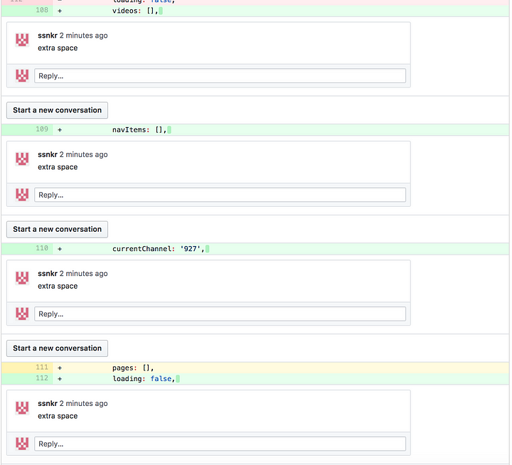
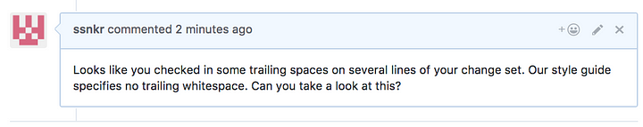
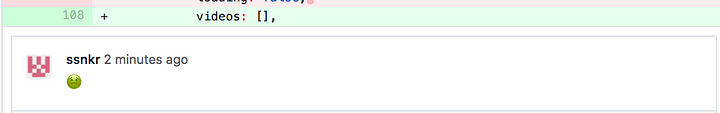
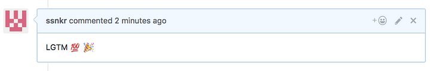
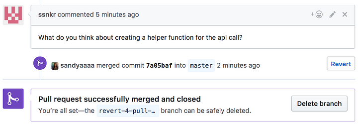

# Unlearning toxic behaviors in a code review culture
I’ve listed below some common unhelpful behaviors people display during code reviews, and some recommendations on how software teams can make their teams more supportive by refusing to normalize toxicity. All of the behaviors I describe were either witnessed by me or happened to an industry contact of mine. I’ve been guilty of several of these behaviors in the past, too.

## Unhelpful behavior #1: passing off opinion as fact
Don’t make claims unless you can cite documentation, formalized guidelines, and coding examples to back those claims up. People need to know why they are being asked to make a change, and another developer’s personal preference isn’t a good enough argument.

### Instead of saying:

> This component should be stateless.

### …provide some context behind the recommendation:

> Since this component doesn’t have any lifecycle methods or state, it could be made a stateless functional component. This will improve performance and readability. *Here* is some documentation.

Passing off opinion as fact is also common when developers discuss style and syntax preferences. These are really important discussions to have, but never in a code review, because style and syntax have nothing to do with the issue the developer was initially trying to solve.

Have these discussions separately and decide which style guidelines you will be following as a group. Implement a [linter](http://www.jslint.com/) and an {automatic code fixer](https://atom.io/packages/atom-beautify). This way, you can reference your style guidelines, and not your personal opinion, during the code review when you see inconsistencies.

It is especially important not to pass off your opinion as fact when you have higher rank and authority within your team or company. If you do this, developers will feel they have no choice but to quietly implement your demands.

## Unhelpful behavior #2: overwhelming with an avalanche of comments
When a person makes an error, chances are high that they have made the same error in several places in their changeset. I have noticed that reviewers sometimes point out every single one of an error’s many occurrences instead of leaving one detailed note with links to helpful resources.

Consolidating comments allows you to convey the same message without overwhelming the review seeker. An avalanche of comments for one problem, duplicated, comes off as nitpicking.

Unhelpful and overwhelming:

#### Leaving multiple comments for “one error, duplicated” (trailing whitespaces)

More helpful:

#### Consolidating feedback

I can understand the argument that pointing out every place an error occurs on a PR can sometimes be useful, since the comment disappears when the developer resolves the issue in subsequent commits. However, after this error has occurred across a changeset, it should be clear that the developer was not aware of a certain guideline and simply needs to be pointed to the correct resources.

## Unhelpful behavior #3: asking engineers to solve problems they didn’t cause “while they are at it”
Avoid asking developers to solve issues that aren’t directly related to their changeset or the problem their changeset is trying to solve. Even if a developer is extending or modifying a messy part of the code that is rife with bad practices, don’t ask the developer to fix them in that pull request just because their changeset happens to touch the messy code.

I am not suggesting that developers should feel no accountability for code just because they didn’t initially introduce it. In fact, it is not collaborative to say something like, “not my code, not my problem.” I am just suggesting that it would be more appropriate to create a separate ticket and PR to address the messy code. This way, you avoid drastically increasing the scope of someone’s work, but the messy code still gets fixed.

TL;DR: Don’t ask devs to fix problems “while they are at it.” If the code solves the issue/ticket the dev was working on and doesn’t introduce any new issues to the codebase, give the pull request a “thumbs up” and then create a ticket to clean up the bad code.

## Unhelpful behavior #4: asking judgmental questions
Avoid asking judgmental questions like:

> Why didn’t you just do ___ here?”

Asking such questions implies that a perceived simple solution should have been obvious. It also forces developers to have to defend themselves.

Oftentimes, these judgmental questions are just veiled demands. Instead, provide a recommendation (with documentation and citations) and leave out harsh words.

> You can do ___, which has the benefit of ____.

## Unhelpful behavior #5: being sarcastic
There is no appropriate time to be sarcastic when offering someone feedback. Sarcastic comments tend not to provide context or actionable feedback. Instead, describe the issue with details and provide recommendations, but leave the caustic jokes out.

Unhelpful:

> Did you even test this code before you checked it in?

Helpful:

> This breaks when you enter a negative number. Can you please address this case?

Here is another example of [a code review comment that isn’t funny or helpful](https://techblog.workiva.com/tech-blog/we-are-ruthless-code-reviews):

> I don’t mean we’re mean-spirited. I just mean that we are merciless. You’ll notice that I left the comment “Beep!” on the imports of every file you touched. What I meant was, “Your imports violate our standard convention — we order them by built-ins, then third party, and then project level,” but that was too much to type on every file.

In the above example, “beep!” is not helpful or descriptive. This practice is simply pedantic humor that does nothing to better the review seeker.

## Unhelpful behavior #6: using emojis instead of statements to point out issues
Avoid using the thumbs-down or puke emoji to point out issues in code. This is as unhelpful as sarcasm for similar reasons. Emojis are cryptic and easy to misconstrue. Emojis waste peoples’ time as they try to figure out what you mean.

#### Don’t use emojis to point out coding problems

You shouldn’t be having visceral reactions to peoples’ coding mistakes anyway.

It’s okay to use emojis like “thumbs-up” or “hooray” to signify that code looks good, but don’t use them to point out problems.

#### Emojis are great when used to praise

## Unhelpful behavior #7: not replying to all comments
Review seekers can contribute to unsupportive environments, too. If you merge code without addressing all the feedback, people are left wondering why they bothered to help you, and you send the message that some opinions are worth more than others.

If a comment is out of scope or you won’t be taking action on the feedback, just provide a brief note explaining why.

Don’t ghost people.

#### Merging code without addressing all the feedback

## Unhelpful behavior #8: ignoring toxic behaviors from high performers
Toxic behaviors should not be ignored or deemphasized because a developer is a high performer and extremely productive. Though this developer might be doing a fantastic job, it is important to keep in mind that this developer’s toxic behaviors make them draining and stressful to work with for other developers.

On working with developers who commonly display toxic behaviors:

> Others will find working with this individual draining and demotivating. They’ll find themselves going to great lengths to avoid interacting with them, even if it means negatively impacting their own ability to complete tasks. Communication will shut down throughout your organization. If it becomes bad, your team will start looking for opportunities elsewhere. While you deal with the fallout of the exodus of talent and failing projects, this particular kind of developer will happily continue working as if nothing was wrong. — <b>Joseph Gefroh</b>

Not taking steps to unlearn these toxic behaviors can have serious setbacks for the team, as developers feel overwhelmed, attacked, and demotivated. They start to dread the feedback processes that are supposed to help them grow.

I would personally feel a lot of anxiety whenever I got an email that a previous coworker (who was known for delivering toxic, unhelpful feedback) had commented on my pull request. Though toxic behaviors affect everyone differently, we can all agree that no one benefits from this toxicity.

Note: I want to be clear that slipping up and displaying one of the above toxic behaviors alone doesn’t make a developer “toxic.” Repeat offenses and patterns of caustic feedback say a lot, though.

# Helpful Code Review Practices
The following are some recommendations that can apply to any person in a collaborative, feedback-driven environment, even if they are filtered through the lens of a software engineer’s eyes and are in the context of code reviews.

## Helpful Behavior #1: use questions or recommendations to drive dialog
Never make demands for people to implement changes or ask judgmental questions, because this does not open up a dialog between you and the person whose code you are reviewing.

> Why didn’t you just pull these translations into a constants file?

Though the above is a question, it doesn’t create a dialog between you and your review seeker. It just forces them to defend themselves. Instead, ask what the review seeker thinks of your proposed solution, like:

> What do you think about pulling these translations into a constants file? There are a lot, and a separate file might make sense at this point

…or make a recommendation like:

> You introduced a lot of translation calls for “feature x” in this file. It might make sense to create a separate file devoted to “feature x” constants.

## Helpful Behavior #2: collaborate, don’t back-seat drive
When you pair-program with another person, you should be there to ask questions, debate, and point to resources.

> “…when you want to help out or work with others, you should fully engage and not just butt in sporadically” — [<b>Recurse Center’s User Manual</b>](https://www.recurse.com/manual#no-backseat-driving)

## Helpful Behavior #3: respond to every comment
If you as a review seeker don’t plan to apply a person’s feedback, just leave a note letting them know. Don’t ignore those who take time to help you.

For example,

> Person A: What do you think about creating a helper function for this api call? Looks good to me otherwise

> Person B: That line wasn’t part of my changeset. I’ll merge this code for now, but I’ll also create a separate GitHub issue for the api call and put it in our group’s backlog of to-do items.

## Helpful Behavior #4: know when to take a discussion offline
After dozens of contrasting PR comments and proposed solutions, it should be clear that online communication has become unproductive for the issue at hand. Send a meeting hit to involved members to discuss the issue offline.

This way, your group can come to a decision more quickly and apply the solution.

> The kinds of problems that take hours and tons of comments can usually be resolved in a few minutes of productive talk. — <b>Tidy Java</b>

## Helpful Behavior #5: use opportunities to teach, and don’t show off
Before choosing to participate in a code review, ask yourself:

> Is your comment helping the other developer learn or are you nitpicking to participate?

Reflect on why you are participating. Remember that the goal behind code reviews is to teach and help other developers grow. The goal isn’t to grandstand.

## Helpful Behavior #6: don’t show surprise
Be careful not to show surprise that someone doesn’t have the same knowledge that you do on a topic. Being comfortable admitting you lack experience with a topic is a great way to ask for help. Don’t make people feel bad that they “should already have known” this piece of info.

For more on this, see Recurse Center’s Social Rule [“Don’t Feign Surprise”](https://www.recurse.com/manual#no-feigned-surprise)

## Helpful Behavior #7: automate what can be
Reviewing issues that can be caught by linters, git hooks, or automated tests are unhelpful because they often result in an avalanche of comments and come off as nitpicking. People are not particularly good at catching these issues, which is why automation tools exist.

There are also tools out there that will run your tests when code is checked in and display warnings that a changeset is in violation of any of these tests. TeamCity and Jenkins CI both offer this functionality.

Also, use git hooks. Git hooks run tests and linters when someone tries to check code in and they will intercept the commit if any buggy, unlinted code was introduced.

Let the tool point out issues so people don’t have to.

## Helpful Behavior #8: refuse to normalize toxic behavior
Don’t join in and contribute to code review toxicity because it seems like the status quo, a hazing ritual for new developers, or just the way things are.

Search for teammates who are supportive and who will back you up.

If you notice someone being unhelpful during code reviews, consider letting them know (if you feel safe in your role/company doing so) and be direct.

## Helpful Behavior #9: managers — hire carefully, listen to your team, and enforce
Managers have a lot of power to create positive and supportive cultures on their teams.

To paraphrase the advice from [“Toxic Developers Considered Harmful”](https://medium.com/@jgefroh/toxic-developers-considered-harmful-f7ea1494d4c0):

- Prevent toxic developers from joining your team. During the hiring process, don’t just stress the technical. Learn how your candidate collaborates and communicates. Critically analyze their work and see how they react. Make sure every hire is a culture add, not just a culture fit.
- When toxic developers trickle in or you inherit them, ask your direct reports how their experience is working with others on the team during 1:1’s. If you have a toxic dev, your direct reports’ feedback will show it.
- Talk to your toxic dev. Give them specific examples and actionable feedback. Work with them throughout your manager/direct report relationship.
- Don’t isolate the toxic developer (*)
- Iterate that you expect your team to contribute to a supportive environment
(*) Though the article suggests to isolate toxic developers, I believe it’s important to encourage the toxic developer to continue to collaborate with the rest of the team, but in more healthy ways. Isolating toxic workers won’t solve the problem. Though giving this dev independent work allows the team to suffer less toxicity in the short run, this toxic developer has not unlearned unhelpful behaviors. They’ve just lost the platform to display these behaviors.

## Helpful Behavior #10: set the standard as your team is small and growing
Teams that are small enough can adopt ideas and implement them from the start. Even if you don’t think it’s necessary to set a standard of what is and isn’t okay because your team is currently collaborating well, remember that you want your team to stay great as you invite new members in.

## Helpful Behavior #11: understand you might be part of the problem
In order to foster more supportive environments, it’s important for people to be honest with themselves and reflect on any unhelpful behaviors they may have ever displayed.

As a junior engineer, there were several occasions when I noticed a bug in someone’s code and delighted, because it meant that I could point it out and be part of the review. I know now that I was using the opportunity to show off, not teach. I am trying to be mindful of this going forward.

I think everyone should have this tough moment of self-reflection too.

One last thing…

I am not policing the content of feedback, just asking people to be mindful of their tone
I know feedback is important and I am not waging a war on feedback. I’m also not asking teams to compromise their code quality. A supportive code review culture and high code quality DON’T have to be mutually exclusive.

I simply hope people take steps to provide constructive, actionable feedback and create more supportive environments, so developers feel comfortable to learn, grow, and make mistakes. We can all improve together.

extracts from [an article of medium](https://medium.com/@sandya.sankarram/unlearning-toxic-behaviors-in-a-code-review-culture-b7c295452a3c), authored by [Sandya Sankarram](https://medium.com/@sandya.sankarram)
