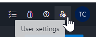
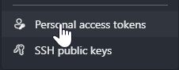
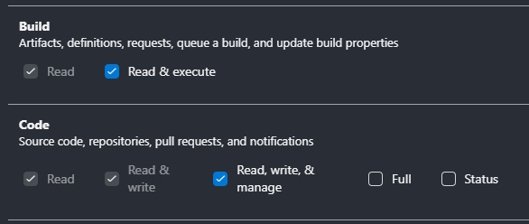

# Introduction
The goal of this repository is to serve as boilerplate / base for all others MFE.
By doing this, all the repositories will have the same base & arbo.

[DAT](https://kpmgfr.visualstudio.com/Constellation/_wiki/wikis/Constellation.wiki/16910/Boilerplate)

# TODO
- clean warnings in browser's devtools console

# Setup
This repository uses two npm packages (eslint config & vite config) that are on the kpmg repository, so updating the .npmrc user is mandatory if it s not already done, (link)[https://kpmgfr.visualstudio.com/Constellation/_artifacts/feed/PlateformePulse/connect/npm]

## For development
* Clone this repository
* Update the shell (@kpmg-shell.js & manifest.js)
```js
// KPMG.Pulse.Front.Shell/src/manifest.js
// ...
im.textContent = JSON.stringify({
  imports: {
    '@kpmg/aMfeAlreadySet': 'http://localhost:8082/src/main.ts',
    '@kpmg/myNewMfe'      : 'http://localhost:8083/src/main.ts', // here we increment the port compare to the last one on the previous line (aMfeAlreadySet = 8082, so myNewMfe = 8083)
  }
})
```

Lauch the command `tools/New-Mfe.ps1` (see commmand documentation, available with `Get-Help tools/New-Mfe.ps1` for details).
```ps1
New-Mfe.ps1 -Name NewMFE -Description "My new MFE" -PAT <PAT>
```

Note: you must be able to create repositories and pipelines in the Constellation project using the provided PAT.

### How to Create a Personal Access Token (PAT) in Azure DevOps

A Personal Access Token (PAT) is an authentication method used to access resources in Azure DevOps, such as repositories and build pipelines. PATs provide secure access without requiring you to enter your username and password.

#### Steps to Create a PAT on Azure DevOps

1. **Navigate to User Settings:**

   Click on your profile picture in the upper-right corner, then select "User settings."

   

2. **Access Personal Access Tokens:**

   In the User settings, select "Personal access tokens" from the left sidebar.

   

3. **Create a New Token:**

   Click on the "New Token" button to create a new PAT.

4. **Configure Token Settings:**

   - **Name:** Give your token a descriptive name that helps you identify its purpose.
   - **Organization:** Choose the Azure DevOps organization for which you want to create the token.
   - **Expiration:** Set the token's expiration date. You can choose from a predefined duration or set a custom date.

5. **Select Scopes:**

   Choose the specific scopes or permissions that the PAT should have:
   
  

6. **Create the Token:**

   Once you have configured the token settings and scopes, click on the "Create" button.

7. **Copy and Save the Token:**

   After the token is created, it will be displayed only once. Make sure to copy the token and save it in a secure place. You won't be able to see it again.

   **Important:** Treat your PAT like a password. Do not share it openly and avoid hardcoding it in your scripts or code.


